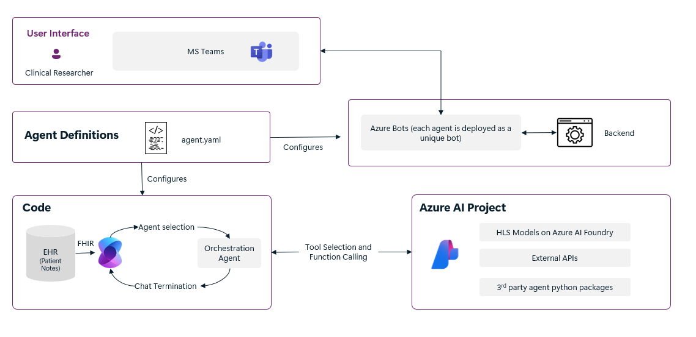

# CareMesh AI

CareMesh AI is a modular multi-agent platform for coordinating general healthcare service workflows. It brings patient-record retrieval, care-status summarization, evidence lookup, optional imaging analysis, clinical-trial discovery, and care-summary export into one extensible application.

> [!IMPORTANT]
> CareMesh AI is intended for research, prototyping, and administrative or informational workflows. It is not a medical device and must not be used as a substitute for diagnosis, treatment decisions, emergency services, or professional clinical judgment. Validate every output before using it in a healthcare context and follow all applicable privacy, security, and regulatory requirements.

## What it provides

- A coordinating agent that routes requests to the right specialist.
- Patient-history retrieval from Blob Storage, HL7 FHIR, or Microsoft Fabric.
- General patient-status summaries and care-navigation support.
- Evidence-grounded health research through an optional GraphRAG integration.
- Optional chest X-ray analysis and clinical-trial search tools.
- Microsoft Teams bots and a React web client.
- Exportable Word care summaries.
- Azure infrastructure-as-code with managed identity authentication.

## Architecture



Agent behavior is configured in `src/scenarios/<scenario>/config/agents.yaml`. Each enabled agent is deployed as an Azure bot and can participate in a Semantic Kernel group chat. Tools are attached to agents through the matching scenario folder.

```text
caremesh-ai/
|-- democlient/              React chat client
|-- docs/                    User, deployment, and developer guides
|-- infra/                   Azure Bicep modules and sample data
|-- notebooks/               Evaluation and integration notebooks
|-- scripts/                 Build, deployment, and Teams utilities
|-- src/
|   |-- bots/                Bot adapters and middleware
|   |-- data_models/         Storage and healthcare data access
|   |-- evaluation/          Conversation evaluation framework
|   |-- routes/              API and view endpoints
|   `-- scenarios/           Agent configurations, prompts, and tools
`-- teamsApp/                Microsoft Teams manifest template
```

## Default agent roles

- **Orchestrator** coordinates requests, confirms the plan, and delegates one task at a time.
- **PatientHistory** retrieves and organizes patient records without interpreting them.
- **PatientStatus** creates a factual current-state summary and identifies missing information.
- **ClinicalGuidelines** provides educational, evidence-based care considerations with explicit safety limits.
- **MedicalResearch** retrieves source-grounded health information from a configured GraphRAG index.
- **Radiology** optionally analyzes supported chest X-ray inputs.
- **ClinicalTrials** optionally searches for relevant studies when sufficient eligibility data is available.
- **ReportCreation** exports a general care-summary document from validated conversation content.

Specialist agents can be disabled with `EXCLUDED_AGENTS`. The default deployment excludes `MedicalResearch` and `Radiology` until their external services are configured.

## Prerequisites

- Python 3.12 or later
- Node.js 20 or later
- An Azure subscription
- [Azure CLI](https://learn.microsoft.com/cli/azure/install-azure-cli)
- [Azure Developer CLI](https://learn.microsoft.com/azure/developer/azure-developer-cli/install-azd)
- Sufficient Azure OpenAI, App Service, and optional GPU quota
- Owner access to the target resource group, or the delegated permissions described in [contributor provisioning](docs/contributor_provisioning.md)

## Deploy with Azure Developer CLI

Authenticate:

```sh
az login
azd auth login
```

Create a short environment name and deploy:

```sh
azd env new caredev
azd up
```

Useful optional settings:

```sh
# Select the clinical-note source: blob, fhir, or fabric
azd env set CLINICAL_NOTES_SOURCE fhir

# Disable optional agents that are not configured
azd env set EXCLUDED_AGENTS "MedicalResearch,Radiology"

# Permit a developer workstation to reach the web client
azd env set ADDITIONAL_ALLOWED_IPS "203.0.113.10/32"
```

Provisioning creates billable Azure resources. Review quota, regions, networking, and access-control settings before running `azd up`.

## Run the web client locally

```sh
cd democlient
npm install
npm run dev
```

See [the client guide](democlient/README.md) for environment variables and build commands.

## Add the bots to Microsoft Teams

After deployment, generate and upload the Teams packages:

```powershell
.\scripts\uploadPackage.ps1 -directory .\output -chatOrMeeting "<chat-id-or-meeting-link>"
```

For shell environments:

```sh
./scripts/uploadPackage.sh ./output "<chat-id-or-meeting-link>"
```

See [the Teams guide](docs/teams.md) for permissions, chat IDs, meetings, and manual installation.

## Configure healthcare data

The repository includes synthetic sample records for development. Do not add real protected health information to source control.

- [Data ingestion](docs/data_ingestion.md)
- [Data access architecture](docs/data_access.md)
- [HL7 FHIR integration](docs/fhir_integration.md)
- [Microsoft Fabric integration](docs/fabric/fabric_integration.md)

## Customize agents and tools

Start with [the agent development guide](docs/agent_development.md). A scenario owns its agent prompts, healthcare-agent mappings, OpenAPI definitions, templates, and Python tools. This keeps domain customizations isolated from the shared orchestration runtime.

## Security and responsible use

- Authentication uses Microsoft Entra ID and managed identities.
- Restrict tenant and user access before production use.
- Treat model output as unverified until reviewed by an appropriately qualified person.
- Never use the system for emergencies or autonomous clinical decisions.
- Remove identifiers from development and evaluation data.
- Review the current public endpoint and sample-data exposure notes in [network security](docs/network.md).

For vulnerability reporting, see [SECURITY.md](SECURITY.md).

## Documentation

- [Documentation index](docs/README.md)
- [User guide](docs/user_guide.md)
- [Deployment troubleshooting](docs/troubleshooting.md)
- [Evaluation framework](docs/evaluation.md)
- [Infrastructure](docs/infra.md)
- [Access control](docs/access_control.md)

## Ownership

CareMesh AI is maintained by [hsussmart](https://github.com/hsussmart). Issues and pull requests are welcome in this repository.

## License

Licensed under the MIT License. See [LICENSE](LICENSE). Required copyright and license notices for incorporated code are preserved.
